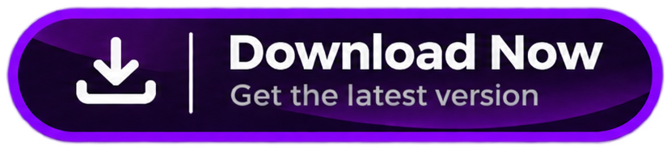

# Instagram Liker Bot - Windows 10 & 11

## Introduction

The Instagram Liker Bot is a specialized software tool designed to automate the process of liking posts on Instagram. It addresses the common challenge faced by users who want to boost their engagement on the platform without spending countless hours manually liking posts. This bot allows users to efficiently manage their interactions, helping them gain visibility and potentially increase their follower count.

With practical capabilities such as automated liking based on user-defined parameters, the Instagram Liker Bot streamlines social media engagement. Users can customize their liking preferences, enabling them to target specific hashtags, users, or locations. This flexibility ensures that the bot acts in a way that aligns with the user's social media strategy while saving valuable time. The bot serves as a valuable asset for individuals, influencers, and businesses alike, who aim to enhance their social media presence effectively and efficiently.

---

## System Requirements

| Requirement            | Details                                           |
|-----------------------|---------------------------------------------------|
| Supported OS          | Windows 10, Windows 11 (x64 architecture)       |
| Processor             | Intel i3 or higher recommended                    |
| RAM                   | Minimum 4GB (8GB recommended for optimal performance) |
| Storage               | At least 200MB of free space                      |
| Permissions           | Standard user permissions required                |
| Internet Connection    | Required for Instagram API access                 |
| Dependencies          | .NET Framework 4.5 or higher                      |

The bot is designed to run on Windows 10 and 11 with x64 architecture, ensuring compatibility with modern systems. While specific processor and RAM requirements are not explicitly stated, it is advisable to have at least an Intel i3 processor and 4GB of RAM for optimal performance. Users should also ensure they have sufficient storage space for the application and any associated logs or data the bot generates.

---

## Features

- **Automated Liking**: The bot can automatically like posts based on specified criteria, helping to maintain an active presence on Instagram without manual effort. This feature is particularly beneficial for users aiming to increase their post engagement rates.

- **Customizable Targeting**: Users can set parameters to target specific hashtags, users, or geographic locations, allowing for more strategic engagement. For example, if you are a photographer, you might want to target hashtags like #Photography or #NaturePhotography to connect with potential followers interested in your niche.

- **User-Friendly Interface**: Designed with simplicity in mind, the interface is intuitive, making it accessible even for users who are not tech-savvy. The layout is clean and provides easy navigation between settings and logs.

- **Activity Logs**: The bot keeps track of its actions, providing users with an overview of posts liked and engagement metrics. Users can review these logs to analyze their engagement strategies and adjust their parameters accordingly.

- **Scheduled Operations**: Users can schedule when the bot should perform liking activities, ensuring that engagement occurs at optimal times for visibility. For instance, you can set the bot to operate during peak hours when your target audience is most active.

- **Multi-Account Support**: The Instagram Liker Bot allows users to manage multiple accounts, making it ideal for social media managers or users with various profiles. This feature enables users to streamline their engagement strategy across different brands or personal accounts.

- **Real-Time Updates**: The bot can respond to changes in Instagram’s API, ensuring that its functionalities remain effective and up-to-date. Regular updates help mitigate compatibility issues and ensure the bot continues to perform its intended functions.

- **Privacy Protection**: The bot includes privacy features that help safeguard user information while interacting with the Instagram platform. This is crucial as it protects users from potential data breaches and ensures compliance with privacy regulations.

- **Lightweight Design**: The software is designed to be resource-efficient, ensuring it does not slow down the user’s system while running. Users can continue their routine tasks without noticeable lag or performance drops.

- **Community Support**: Users can access a community of fellow bot users for tips, troubleshooting, and sharing best practices. This support network can be invaluable for new users seeking guidance or experienced users looking to optimize their strategies.

---

## How It Works

1. **Install the Bot**: Download and install the Instagram Liker Bot on your Windows 10 or 11 machine. Follow any provided installation instructions, ensuring that you have the necessary permissions to install software on your device.

2. **Configure Settings**: Open the bot and configure your liking preferences, including target hashtags, users, and any scheduling options you wish to use. For instance, you may choose to like posts that contain hashtags relevant to your niche, such as #Travel for a travel influencer.

3. **Connect to Instagram**: Log in to your Instagram account through the bot interface, granting the necessary permissions for the bot to operate. Ensure that you use your primary Instagram credentials for this step.

4. **Start Automating**: Once set up, start the bot to begin automatically liking posts based on your specified criteria. Monitor the activity logs for updates on its performance. The bot will operate quietly in the background while you focus on other tasks.

5. **Analyze and Adjust**: Regularly check the activity logs and engagement metrics to evaluate the effectiveness of your liking strategy. If you find that certain hashtags or accounts yield better results, adjust your settings accordingly.

---

## Compatibility

**Operating Systems and Architecture**  
The Instagram Liker Bot is compatible with Windows 10 and Windows 11, specifically for x64 architecture. It is optimized for these environments to ensure a smooth user experience.

**Hardware Requirements**  
While specific hardware requirements are not explicitly mentioned, the bot is designed to run efficiently on standard consumer hardware. Ideally, users should have at least an Intel i3 processor and a minimum of 4GB of RAM for the best performance.

**Runtime Dependencies**  
The bot requires the .NET Framework 4.5 or higher for proper functionality. Users should ensure that this framework is installed on their systems to avoid compatibility issues.

**Limitations and Notes**  
Users should be aware of Instagram's policies on automation to avoid potential account restrictions. Excessive automation or violation of Instagram's terms of service can lead to account suspensions or bans. It's advisable to use the bot judiciously and monitor the frequency of likes to stay within Instagram's limits.

The bot may not work effectively if Instagram changes its API or usage policies. Users are encouraged to stay updated with official Instagram communications regarding any changes that may impact the bot's performance.

---

## FAQ

### What is the primary purpose of the Instagram Liker Bot?
The Instagram Liker Bot is designed to automate the liking of posts on Instagram, allowing users to engage with content more efficiently. It is especially useful for users looking to increase their visibility and follower engagement without manual effort.

### How do I install and set up the Instagram Liker Bot?
To install the bot, download it from the designated source and follow the installation instructions provided. After installation, you will need to configure your liking preferences and connect your Instagram account to start using the bot effectively.

### Is the Instagram Liker Bot compatible with all versions of Windows?
The bot is specifically compatible with Windows 10 and Windows 11 operating systems, designed for x64 architecture. Other versions or architectures may not support the software effectively, resulting in potential errors or performance issues.

### What should I do if the bot is not liking posts as intended?
If the bot is not functioning as expected, check your settings to ensure that they are correctly configured. Additionally, verify that your Instagram account is in good standing and review any updates or changes made to the Instagram API that may affect the bot's operation. Restarting the bot or reinstalling it can also resolve some common issues.

### Can I use the Instagram Liker Bot for multiple accounts?
Yes, the Instagram Liker Bot supports multi-account management, allowing users to switch between different Instagram profiles within the same interface. This feature is particularly useful for social media managers or users with multiple accounts, enabling them to execute targeted engagement strategies across various profiles.

---

## Disclaimer

Please note that features and performance can vary based on the version of the software and individual system configurations. It is advisable to back up important data before making any significant changes or using automated tools on social media platforms. Users should understand that while automation can significantly enhance engagement, it should be used responsibly to comply with Instagram's terms of service.

---

## License

The licensing terms for the Instagram Liker Bot are not specified. Users should consult the license distributed with the software or the vendor's official terms for more information regarding usage rights. It is important to respect the terms and conditions associated with the software to avoid any legal issues or account restrictions.
